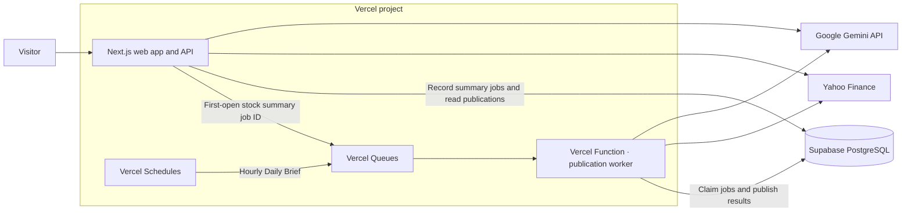

# ADR 0006 Vercel hosting and scheduled execution

Status: Accepted

Date: 2026-11-15

Updated: 2026-11-20

Decision sources: The owner chose Vercel for web hosting in the SFA-4 working session on 15 November 2026. On 20 November 2026, the owner chose Vercel for the web app and worker in the stakeholder proposal, starting the worker on Hobby and revisiting the choice if it cannot meet demand.

Related requirements: [FR-03 Daily Brief publication](../functional-requirements.md#fr-03-daily-brief-content-and-publication), [FR-11 first-open stock summaries](../functional-requirements.md#fr-11-shared-daily-stock-summary), and [Q08 delivery expectations](../requirements-questions.md#q08-release-quality-and-evaluation)

## Context

The Next.js application serves interactive requests. A separate worker execution runs the hourly Daily Brief and generates a stock summary when a visitor first opens the listing that Thai calendar day. Development needs a way to run either job on demand.

## Decision and rationale

Deploy the Next.js app and publication worker in the same Vercel project. Vercel manages Next.js deployments, pull request previews, and CDN caching. A separate Vercel Function runs the worker asynchronously, so visitor requests can return while publication work continues. Start the worker on Vercel Hobby. [Next.js on Vercel](https://vercel.com/docs/frameworks/full-stack/nextjs), [Vercel Hobby](https://vercel.com/docs/plans/hobby)

- Vercel Schedules publishes an hourly Daily Brief message to Vercel Queues. [Vercel Schedules configuration](https://vercel.com/docs/schedules/configuration)
- On a listing's first open of the Thai calendar day, the web server records the stock-summary job in Supabase PostgreSQL and queues its job ID. Vercel Queues invokes the same worker for both message types. [Vercel Queues](https://vercel.com/docs/queues)

The worker claims each job and commits completed publications in Supabase PostgreSQL. The web app reads publications from that database. Keep the single-job entry point independent of Next.js request APIs so it can run locally or move to another host. [ADR 0001](0001-nextjs-application-and-shared-workspace.md), [ADR 0004](0004-shared-publication-consistency.md), [ADR 0005](0005-supabase-postgres-for-shared-and-private-data.md)

### Deployment diagram for the stakeholder proposal

## Alternatives and tradeoffs

- **Cloud Run service for Next.js.** Cloud Run gives the team control over container scaling and access through Google Cloud IAM. The team owns the build and deployment setup and any shared cache needed across Next.js instances. Vercel handles more of that setup for this application. [Next.js on Cloud Run](https://docs.cloud.google.com/run/docs/quickstarts/frameworks/deploy-nextjs-service), [Cloud Run overview](https://docs.cloud.google.com/run/docs/overview/what-is-cloud-run), [Next.js self-hosting](https://nextjs.org/docs/app/guides/self-hosting)
- **Cloud Run Jobs.** Cloud Scheduler starts the hourly Daily Brief. The web server can start a stock-summary job through the authenticated Cloud Run API after it records the job in PostgreSQL. Cloud Run Jobs gives the worker a separate deployment and a longer task timeout. [Scheduled jobs](https://docs.cloud.google.com/run/docs/execute/jobs-on-schedule), [On-demand jobs](https://docs.cloud.google.com/run/docs/execute/jobs), [Task timeout](https://docs.cloud.google.com/run/docs/configuring/task-timeout)

## Consequences

Vercel Schedules and Queues are in beta. Hobby has a 15-minute scheduling window and a five-minute function limit with Fluid Compute. Measure Daily Brief runtime with representative news, stock-summary queue delay, and usage against plan limits. Revisit the worker host if those limits prevent timely publications. Review the Vercel plan if the deployment moves into commercial or team use. [Schedules limits](https://vercel.com/docs/schedules/limits), [Queues](https://vercel.com/docs/queues), [Function duration](https://vercel.com/docs/functions/configuring-functions/duration), [Hobby plan](https://vercel.com/docs/plans/hobby)

Keep scheduler failures and delayed runs observable. The worker must tolerate repeated invocation and preserve the last successful publication. [ADR 0004](0004-shared-publication-consistency.md)

## References

- [ADR 0001 Next.js application, background worker, and shared workspace](0001-nextjs-application-and-shared-workspace.md)
- [ADR 0004 Shared publication consistency](0004-shared-publication-consistency.md)
