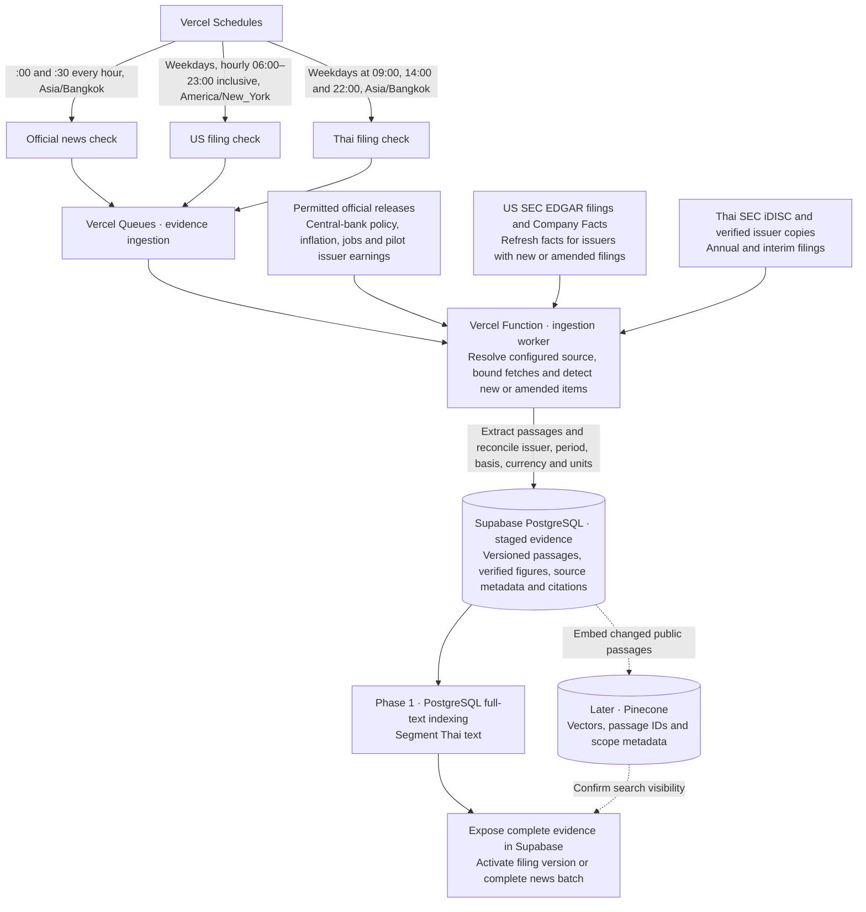
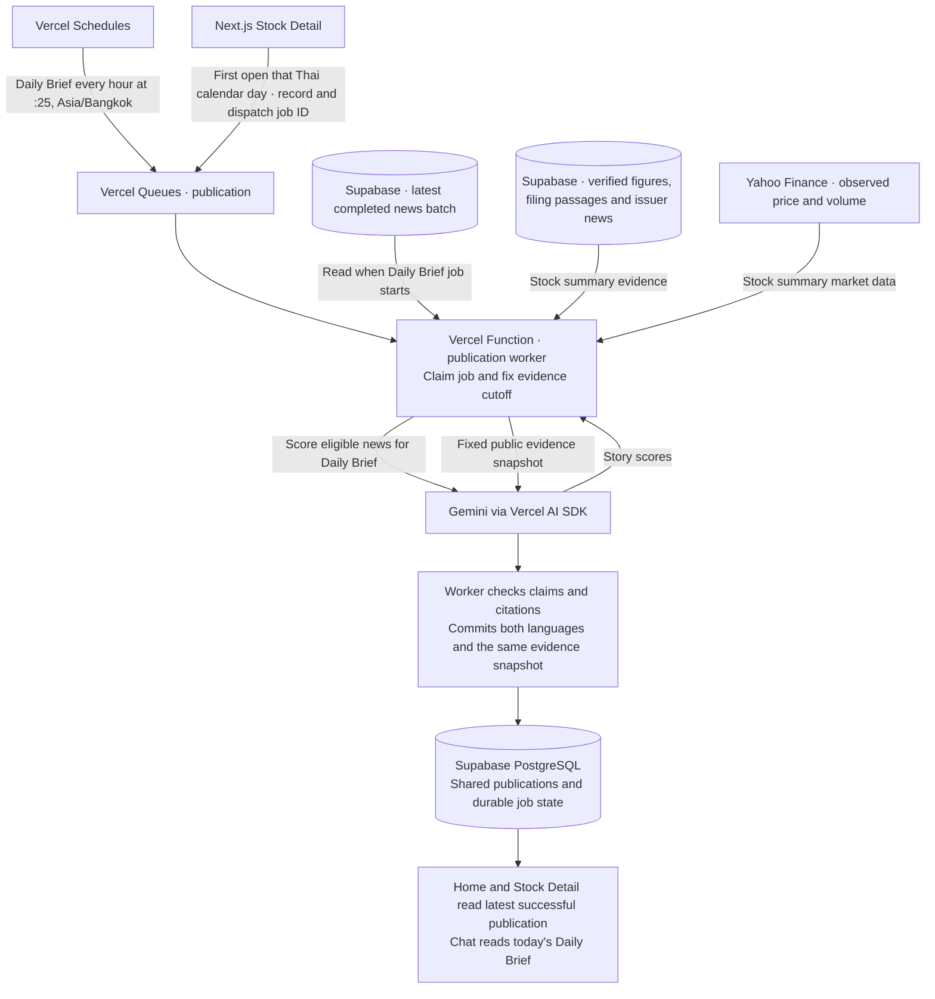
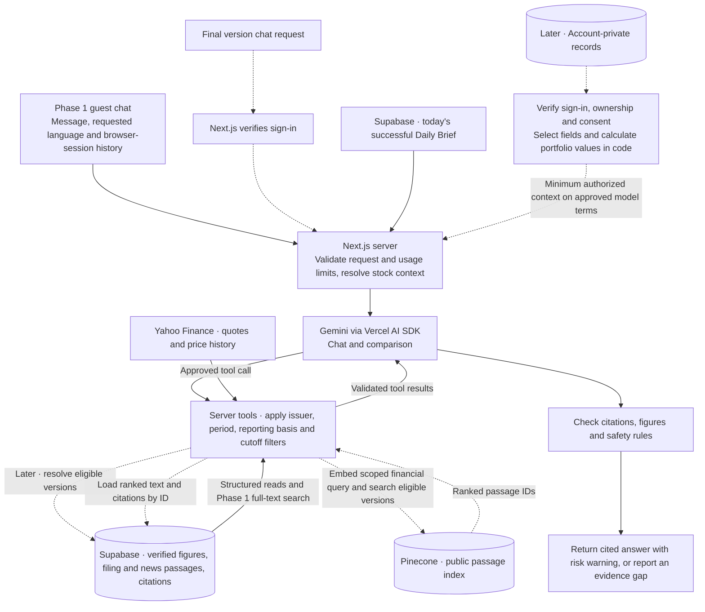
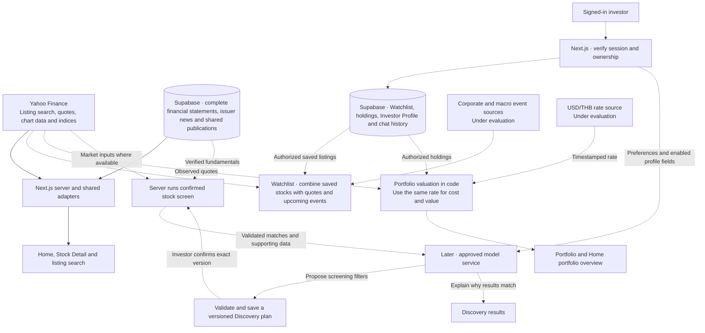

# Backend data flow

This is the backend design for the Phase 1 prototype and later account features. The Yahoo Finance market-data adapter exists today. Scheduled ingestion, evidence storage, publication jobs, and model integration are planned. Dotted arrows show later delivery paths. [Phase 1 deployment diagram](adr/0006-vercel-hosting-and-scheduled-publication-trigger.md#phase-1-deployment-diagram) · [Current server entry points](developer-guide.md#where-to-work) · [Access requirements](functional-requirements.md#fr-21-access-and-languages)

## Scheduled evidence ingestion

The ingestion worker builds the corpus for retrieval-augmented generation (RAG). The same public news feeds the Daily Brief. Live quotes and chart data use the request-time adapter shown below.

The filing pilot covers AAPL, JPM, and WMT in the US and ADVANC, KBANK, and PTT in Thailand. Seed the latest annual report, latest interim filing, and comparable prior-year interim filing for each issuer. Keep the last complete version eligible if an update fails. A news check with zero new stories still completes. [Official news corpus](functional-requirements.md#fr-03-daily-brief-content-and-publication) · [Pilot filing scope](functional-requirements.md#fr-12-financial-data-and-news) · [Evidence retrieval RFC](rfcs/financial-evidence-retrieval.md)

## Shared publications

The hourly brief uses eligible stories published since Bangkok midnight from the latest completed batch at job start. If ingestion fails and no newer completed batch is available, the last successful brief keeps its timestamp and the update shows a delay. The publication worker can resume pending or expired stock-summary claims on its scheduled run. [FR-03](functional-requirements.md#fr-03-daily-brief-content-and-publication) · [First-open workflow](rfcs/ai-workflow-orchestration.md#three-workflow-shapes)

## Request-time evidence and chat

## Other backend reads and later workflows

The event and FX providers remain under evaluation. Portfolio values use observed quotes and current FX under FR-22. [Service options](research/final-architecture-service-options.md) · [Portfolio valuation](functional-requirements.md#fr-22-current-fx-valuation) · [Discovery confirmation](functional-requirements.md#fr-15-discovery-plan-and-user-confirmation)

## What the model receives

| Workflow | Data sent to the model |
| --- | --- |
| Daily Brief | Eligible news since Bangkok midnight from the latest completed batch, with source references and the cutoff. The model scores eligible stories. The worker selects stories in code and sends the resulting snapshot for generation in both languages. |
| Stock summary | The resolved listing, observed price and volume, verified figures and filing passages, issuer news, and the titles, links, periods, and timestamps needed for citations and freshness. The first open of each Thai calendar day starts the job. [FR-11](functional-requirements.md#fr-11-shared-daily-stock-summary) |
| AI Q&A and comparison | The visitor's message, relevant session history, requested language, resolved stock context where applicable, and today's successful Daily Brief where available. Approved tools can add observed quotes, verified figures, and public filing or news passages with citations. Comparisons retrieve each issuer separately and align figures by period, currency, and unit in code. |
| Later account features | The server can add relevant fields from an enabled Investor Profile and only the Watchlist or Portfolio context attached to the current question, subject to provider terms. It applies the same permissions to earlier messages. Discovery uses the model to propose screening criteria and explain results. The server executes only the confirmed plan version. |

Supabase keeps source URLs, document versions, page, section, or table references, reporting periods, and separate publication, observation, and fetch times where available. The later vector path uses the same multilingual embedding model for public passages and scoped evidence queries. The Phase 1 generation model plan uses the Gemini API free tier with provider data restrictions applied by the server. [Provider decision](adr/0003-market-data-and-news-provider-selection.md) · [Retrieval design](rfcs/financial-evidence-retrieval.md) · [AI workflow RFC](rfcs/ai-workflow-orchestration.md)

The worker validates source IDs and bounds network fetches. The server keeps retrieved text separate from instructions, validates tool calls, and checks that citations support the claims before returning an answer. It checks the guest message and history against the model provider's data restrictions before sending them. Use scoped database roles and keep account-private records and visitor conversations out of shared jobs, indexes, outputs, caches, and logs. [Trust and privacy](contracts-and-boundaries.md#trust-and-privacy) · [Phase 1 security release gates](functional-requirements.md#11-quality-and-release-acceptance)

## Decisions for team review

| Decision | Options and evidence needed |
| --- | --- |
| Retrieval rollout | Carry the Phase 1 full-text design and the later Pinecone target into the review. Compare full-text search, Pinecone, and pgvector on the same bilingual evaluation set before approving the embedding model and vector rollout. [Retrieval evaluation](rfcs/financial-evidence-retrieval.md#evidence-needed-to-confirm-the-design) |
| Guest usage and operating limits | Set exact request size, tool-call, retry, and guest concurrency limits. Define the latency and operating budget for Phase 1. [Q08](requirements-questions.md#q08-release-quality-and-evaluation) |
| Later account data | Choose a sign-in method, cross-device behavior, and a model service approved for private data. The agreed profile, chat, and backup retention rules are in Q07. [Q03](requirements-questions.md#q03-access-persistence-and-languages) · [Q07](requirements-questions.md#q07-personalization-and-personal-data-controls) |
