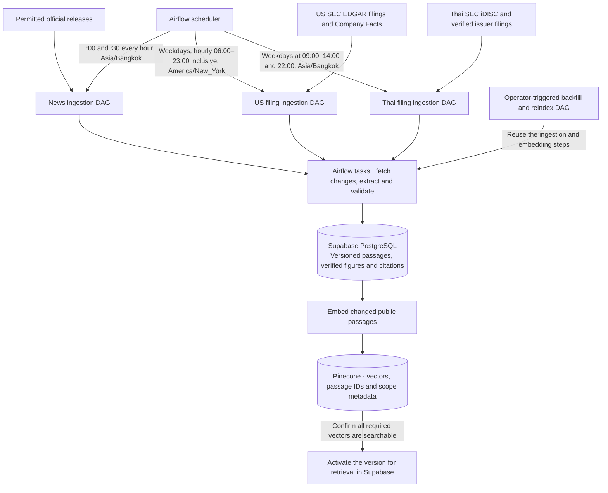
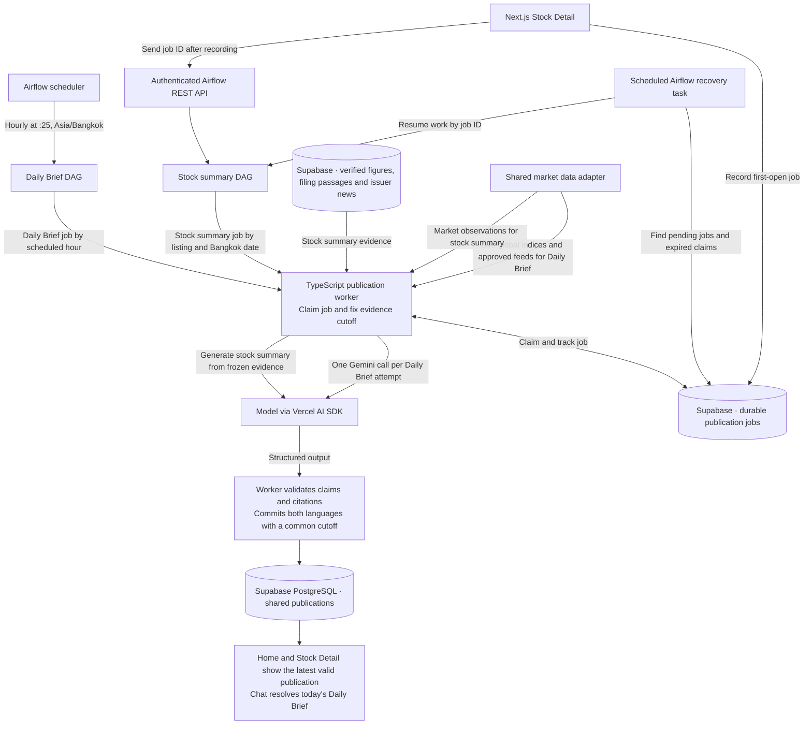
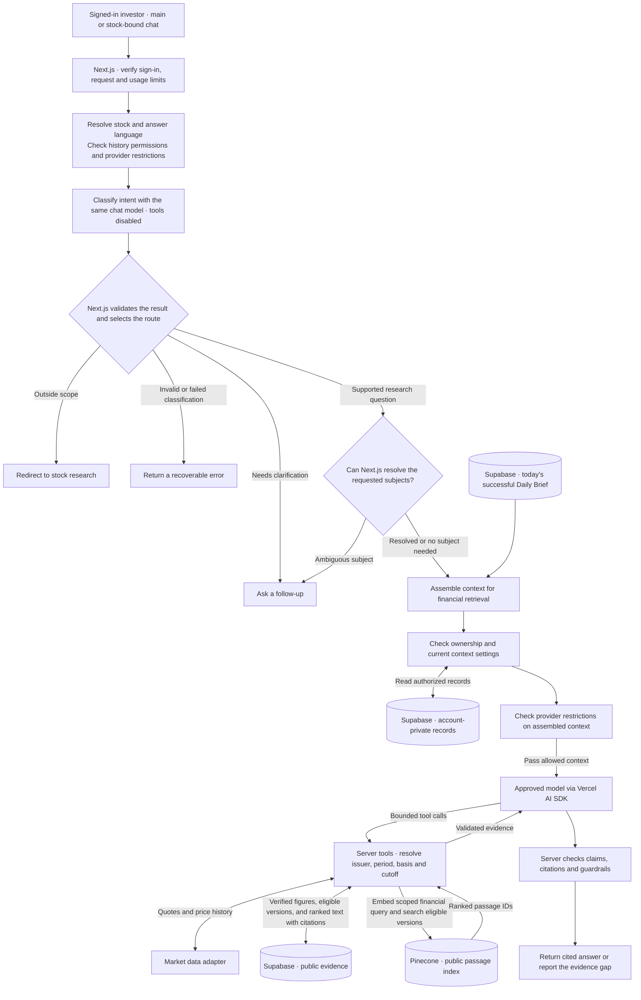
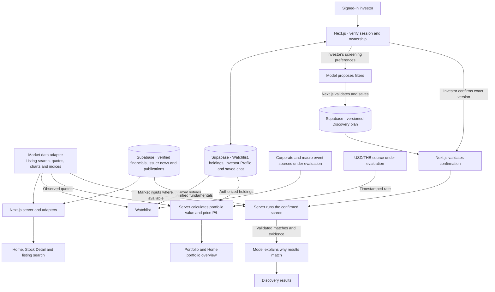

# Backend data flow

These diagrams show the proposed architecture at the end of Phase 2. Airflow runs background jobs, Next.js serves interactive requests, Supabase stores durable state, and Pinecone indexes public evidence. [Final design RFC](final-architecture.md) · [Delivery phases](final-architecture.md#delivery-phases) · [Current server entry points](../developer-guide.md#where-to-work)

## Scheduled evidence ingestion

Airflow ingests public news and filings for retrieval-augmented generation (RAG). The Daily Brief fetches its inputs separately during the publication run.

The [earlier draw.io diagram](diagrams/scheduled-evidence-ingestion.drawio) records the previous ingestion design. The [publication flow](#shared-publications) below shows the current Daily Brief inputs.

A news check with zero new stories still completes. Keep the previous complete version eligible for retrieval if extraction or indexing fails. Limit concurrent backfills and reindexing to leave capacity for routine refreshes and publications. [Evidence retrieval](../rfcs/financial-evidence-retrieval.md#target-design-with-pinecone-vector-search) · [Filing coverage](functional-requirements.md#fr-12-financial-data-and-news) · [Indexing and recovery](final-architecture.md#public-evidence-ingestion-and-rag)

## Shared publications

The Brief uses eligible stories published since Bangkok midnight. The worker fetches the feeds and index observations directly, then calls Gemini with tools disabled. A valid Brief shows supported coverage and source gaps. If an attempt cannot publish, the last successful Brief keeps its timestamp and Home shows the delay. [FR-03](functional-requirements.md#fr-03-daily-brief-content-and-publication) · [Publication workflow](../rfcs/ai-workflow-orchestration.md#three-workflow-shapes)

Next.js records first-open jobs by listing and Bangkok date. Stock Detail polls the server for today's summary and shows a dated earlier summary or a preparing state while it waits. [FR-11](functional-requirements.md#fr-11-shared-daily-stock-summary) · [Airflow job execution](final-architecture.md#airflow-schedules-and-job-execution)

## Request-time evidence and chat

## Other backend reads and workflows

Use the same current USD/THB rate for portfolio cost and value. Discovery uses signed-in access in the proposal, with the access rule open in Q03. [Portfolio valuation](functional-requirements.md#fr-22-current-fx-valuation) · [Discovery confirmation](functional-requirements.md#fr-15-discovery-plan-and-user-confirmation) · [Q03](../requirements-questions.md#q03-access-persistence-and-languages)

## What the model receives

| Workflow | Inputs |
| --- | --- |
| Daily Brief | Validated feed items published since Bangkok midnight and timestamped global stock index observations. One Gemini call produces both languages from the same evidence and cutoff. |
| Stock summary | Resolved listing, observed prices and volume, verified figures and filing passages, issuer news, and source references and timestamps. |
| AI Q&A and comparison | The investor's message, requested language, permitted history, resolved stock context when applicable, and today's Daily Brief when available. Server tools can add quotes, figures, and cited passages. Comparisons retrieve each issuer separately and align periods, currencies, and units in code. |
| Personal context in chat | Relevant fields from an enabled Investor Profile and any Watchlist or Portfolio context attached to the current question. The server applies current permissions when replaying earlier messages and sends private context only under approved model terms. |
| Discovery | Screening preferences to propose a plan, then validated matches and their evidence to explain the results after the user confirms the plan and the server runs it. |

Supabase keeps source URLs, document versions, citation locations, fiscal periods, and separate publication, observation, fetch, and search visibility times where applicable. The same multilingual embedding model handles public passages and scoped evidence queries. [Retrieval design](../rfcs/financial-evidence-retrieval.md)

The worker validates source IDs and bounds network fetches. The server treats retrieved text as untrusted, validates tool calls, and checks citations against the claims they support. Account-private records and chat stay out of shared jobs, indexes, outputs, caches, and logs. [Trust and privacy](../contracts-and-boundaries.md#trust-and-privacy) · [Final design checks](final-architecture.md#evidence-needed-before-acceptance)
