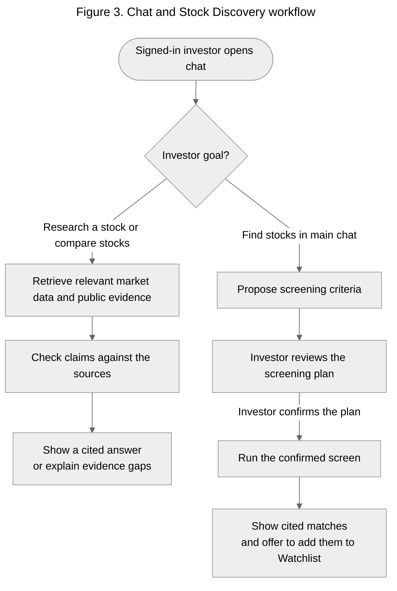

# Chat and Stock Discovery

As shown in Figure 3, a signed-in investor can use chat to research stocks or use Stock Discovery in main chat to find stocks that match their preferences. For research questions, the application checks its claims against public evidence and returns a cited answer. For Stock Discovery, the application proposes screening criteria for the investor to review. The server runs the screen only after the investor confirms the plan, then shows the matches with supporting evidence.

[Detailed Chat and Stock Discovery design](../backend-data-flow.md#request-time-evidence-and-chat)
