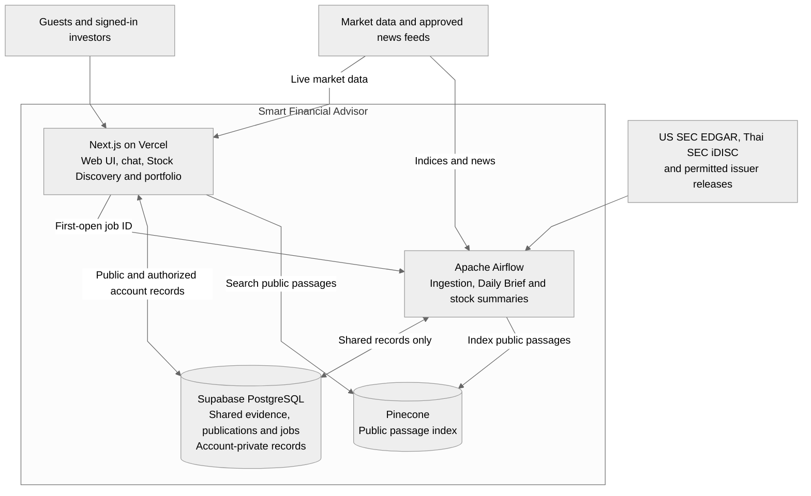

# Smart Financial Advisor system block diagram

Proposed Phase 2 architecture

Guests can browse Home and Stock Detail. Signed-in investors can use chat, Stock Discovery, Watchlist, Portfolio and Investor Profile. The proposed sign-in provider is Supabase Auth.

Airflow fetches live indices and approved news feeds for the hourly Daily Brief. Airflow also generates stock summaries on first open. Both publications use public inputs and are published in Thai and English. Next.js and the publication worker call models through the Vercel AI SDK. Sending private context requires approved provider terms.

[Final architecture](../final-architecture.md) · [Backend data flow](../backend-data-flow.md)
