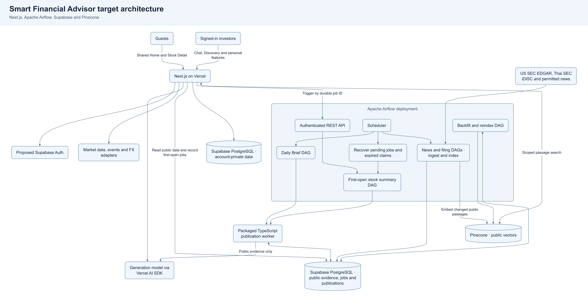
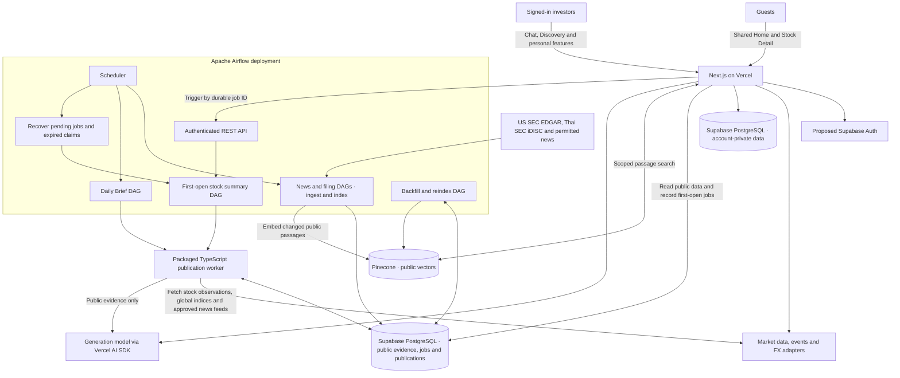

# Smart Financial Advisor final design

Proposed · 21 November 2026

The final version supports guests browsing shared research and signed-in investors using both chat entry points, Watchlist, Portfolio, and Investor Profile. Discovery is part of the target, with signed-in access proposed. Keep Next.js on Vercel, Supabase PostgreSQL for durable state, and Pinecone for public financial evidence retrieval. The owner's preferred design uses Apache Airflow to schedule and execute ingestion, indexing, backfills, and shared publications. [Functional requirements](functional-requirements.md) · [Architecture decisions](../adr/README.md) · [Service research](../research/final-architecture-service-options.md)

The end of Phase 2 is the delivery target for this design. [Delivery phases](#delivery-phases)

## Final product scope and acceptance

The functional requirements remain the source for product behavior and acceptance. Resolve pending rules in the question record. The target design covers all six product areas and applies the account, evidence, and publication rules across them.

| Area | Final behavior and design | Decisions to close |
| --- | --- | --- |
| Shared Home and Stock Detail | Guests can read shared content. Home shows one-minute index updates and the bilingual hourly Daily Brief, which combines a global stock index snapshot and a news roundup. The archive keeps one brief per Bangkok date. Stock Detail has page-open and manual quotes, charts, filings, financials, news, and a bilingual first-open summary. Source times and unavailable states are visible. [FR-01 to FR-05](functional-requirements.md#2-shared-behavior) · [FR-11 and FR-12](functional-requirements.md#6-stock-detail) | Confirm supported listing and feed coverage, rights, and tolerances for stale data. [Q04](../requirements-questions.md#q04-supported-data-and-stock-coverage) |
| Accounts and chat | Both chat entry points and brief follow-ups require sign-in. The server resolves today's brief and the selected stock. Main history combines both entry points, and Stock Detail shows explicitly linked conversations. Saving chats is opt-in, with 90-day expiry after the last message and earlier deletion available. Thai and English are supported across the interface, shared publications, and chat. Supabase Auth is the proposed sign-in service. [FR-13 and FR-14](functional-requirements.md#fr-13-stock-bound-chat) · [FR-19 to FR-21](functional-requirements.md#9-ai-evidence-and-guardrails) | Select sign-in methods, confirm device restoration and locale behavior, and approve model terms for private data. [Q03](../requirements-questions.md#q03-access-persistence-and-languages) · [Q07](../requirements-questions.md#q07-personalization-and-personal-data-controls) |
| Watchlist and Investor Profile | Store Watchlist and the optional Investor Profile under account ownership. Watchlist supports up to 20 stocks and shows prices, relevant news, and events. Profile use starts off. Each question needs its own Watchlist or Portfolio attachment. Apply current permissions when replaying earlier messages and summaries. [FR-07 and FR-08](functional-requirements.md#4-my-watchlist) · [FR-17 and FR-18](functional-requirements.md#8-investor-profile) · [FR-20](functional-requirements.md#fr-20-personal-context-isolation) | Confirm persistence, event coverage, and Watchlist refresh. [Q03](../requirements-questions.md#q03-access-persistence-and-languages) · [Q04](../requirements-questions.md#q04-supported-data-and-stock-coverage) |
| Discovery | The server stores a versioned screening plan. Execute the confirmed version against verified stock data, cite the evidence behind each match, and let users add results to Watchlist. Propose account ownership for plan and confirmation state. [FR-15 and FR-16](functional-requirements.md#fr-15-discovery-plan-and-user-confirmation) · [Workflow RFC](../rfcs/ai-workflow-orchestration.md#three-workflow-shapes) | Confirm guest access, filters, ranking, and result limits. [Q03](../requirements-questions.md#q03-access-persistence-and-languages) · [Q05](../requirements-questions.md#q05-chat-and-discovery-boundaries) |
| Portfolio and Home portfolio overview | Users maintain purchase positions for current holdings. The server calculates valuation and price P/L in code. Use the same current USD/THB rate for cost and value, with FX gains and losses excluded. Refresh portfolio prices every minute. [FR-06](functional-requirements.md#fr-06-portfolio-overview-on-home) · [FR-09 and FR-10](functional-requirements.md#5-portfolio) · [FR-22](functional-requirements.md#fr-22-current-fx-valuation) | Set position and summary rules, FX freshness, and the previous-close convention. [Q01](../requirements-questions.md#q01-portfolio-accounting-and-summaries) · [Q02](../requirements-questions.md#q02-thb-conversion-and-daily-profit-or-loss) |

## Runtime and data flow

The static illustrations show an earlier publication design. See the [publication flow](backend-data-flow.md#shared-publications) for the current Daily Brief inputs.

[Open the detailed Figure 1 in draw.io](diagrams/smart-financial-advisor-target-architecture.drawio) · [Download the overview as SVG](diagrams/smart-financial-advisor-target-architecture.svg)

Vercel, the Vercel design, Next.js and related marks, designs and logos are trademarks or registered trademarks of Vercel, Inc. or its affiliates in the US and other countries.

Detailed runtime and data flow

[Backend data flow](backend-data-flow.md) shows the ingestion, publication, and request paths in detail.

- **Interactive requests.** Next.js serves the UI and validates identity, ownership, language, and financial scope. It reads shared content, live market data, and authorized account records through server-side adapters. Keep generation behind the existing server boundary with the Vercel AI SDK. Consider paid Gemini for private context after confirming that the exact service and features permit the intended processing and retention. Implement account deletion and backup restore checks under FR-20. [Contracts and boundaries](../contracts-and-boundaries.md) · [Model options](../research/final-architecture-service-options.md#model-for-private-ai-context)

### Airflow schedules and job execution

Airflow's scheduler creates runs. Its executor starts task processes on Airflow infrastructure. Use an explicit `CronTriggerTimetable` so the cron tick is the run's due time. Record actual task start separately to measure scheduler and worker delay. [Airflow architecture](https://airflow.apache.org/docs/apache-airflow/stable/core-concepts/overview.html) · [Cron trigger timetable](https://airflow.apache.org/docs/task-sdk/stable/api.html#airflow.sdk.CronTriggerTimetable)

| Work | Trigger | Airflow task |
| --- | --- | --- |
| News ingestion | `0,30 * * * *` in `Asia/Bangkok` | Fetch permitted releases and index eligible passages for evidence retrieval. [Evidence retrieval](../rfcs/financial-evidence-retrieval.md#target-design-with-pinecone-vector-search) |
| US filing ingestion | `0 6-23 * * 1-5` in `America/New_York` | Check EDGAR for filings and amendments, and refresh Company Facts for changed issuers. Use Eastern time across daylight-saving changes. [FR-12](functional-requirements.md#fr-12-financial-data-and-news) |
| Thai filing ingestion | `0 9,14,22 * * 1-5` in `Asia/Bangkok` | Check Thai SEC iDISC and verified issuer sources. Extract and validate the filing data and index public passages. [ADR 0003](../adr/0003-market-data-and-news-provider-selection.md) |
| Daily Brief | `25 * * * *` in `Asia/Bangkok` | Fetch global stock indices and approved news feeds through the shared adapter. Use one Gemini call per generation attempt and publish both languages together with one evidence cutoff. [FR-03](functional-requirements.md#fr-03-daily-brief-content-and-publication) · [Publication workflow](../rfcs/ai-workflow-orchestration.md#three-workflow-shapes) |
| First-open stock summary | Next.js triggers a DAG after recording a job for the listing and Bangkok date | Claim the job, generate both languages, and publish them in one transaction. Use the database to recover pending work and expired claims. [FR-11](functional-requirements.md#fr-11-shared-daily-stock-summary) · [ADR 0004](../adr/0004-shared-publication-consistency.md) |
| Historical imports and reindexing | Operator starts a bounded date, source, or document scope | Call the same ingestion and embedding steps with bulk concurrency limits. [Airflow backfill](https://airflow.apache.org/docs/apache-airflow/stable/core-concepts/backfill.html) |

For the first-open trigger, use a server-side Airflow identity scoped to the stock-summary DAG. Send only the durable job ID and use it to deduplicate dispatch and claim the job in Supabase. Wait for Airflow to acknowledge dispatch within a bounded timeout, then return the preparing state while the browser polls for the summary. A scheduled recovery task reclaims pending jobs and expired claims after a failed trigger or worker restart. Set its cadence from the stock-summary wait target in Q08. [First-open workflow](../rfcs/ai-workflow-orchestration.md#three-workflow-shapes) · [Airflow REST API](https://airflow.apache.org/docs/apache-airflow/stable/stable-rest-api-ref.html) · [API authentication](https://airflow.apache.org/docs/apache-airflow/stable/security/api.html)

Run the LLMFA-derived Python extraction and embedding code in Airflow tasks. Have the publication DAGs invoke the packaged TypeScript worker as a Node.js command so the existing workspace contracts and AI SDK design still apply. Use a fixed command and validated job inputs. Interactive chat, live quote requests, and Discovery confirmation stay in Next.js. [ADR 0001](../adr/0001-nextjs-application-and-shared-workspace.md) · [Airflow command operator](https://airflow.apache.org/docs/apache-airflow-providers-standard/stable/operators/bash.html)

### Public evidence ingestion and RAG

1. Fetch new and amended documents in bounded batches. Track progress by source. Extract HTML and PDF text, use OCR when needed, and validate legal issuer, actual fiscal period, reporting basis, currency, and units. Save verified figures, versioned passages, and citation locations in Supabase. Preserve the source publication time, fetch time, and searchable time as distinct values. [Evidence retrieval RFC](../rfcs/financial-evidence-retrieval.md) · [ADR 0005](../adr/0005-supabase-postgres-for-shared-and-private-data.md)
2. Embed new or changed public passages with a multilingual model. Evaluate Pinecone's `multilingual-e5-large` against Thai and English questions before selecting it. Upsert stable passage IDs with scope metadata into Pinecone. Check that all required vectors are searchable before activating the version for retrieval. Keep the previous complete version eligible during failures. [Embedding options](../research/final-architecture-service-options.md#multilingual-embeddings-for-pinecone) · [Pinecone index freshness](https://docs.pinecone.io/guides/data/check-data-freshness)
3. At query time, resolve issuer, market, period, reporting basis, and historical cutoff in server code. Search only eligible public versions, then load the ranked text and citations from Supabase. Read verified figures directly and calculate derived values in code. Private history, holdings, and profile fields stay outside the shared index and ingestion payloads. [FR-19](functional-requirements.md#fr-19-grounded-answers-and-citations) · [FR-20](functional-requirements.md#fr-20-personal-context-isolation)

Backfill the supported financial history in FR-12 and run model-change reindexing as bounded, restartable jobs. Limit their concurrency so routine refreshes and publications retain capacity. Preserve source and document versions and use durable job keys so duplicate dispatches and partial writes converge. Build a replacement index for a model change and switch retrieval after checking its coverage and visibility. The index is rebuildable from public evidence in Supabase. Reconcile expected schedule slots with job records and support scoped replay. Alert when freshness or publication falls outside the agreed window. An earlier or superseded run cannot overwrite a newer publication.

## Reuse and operating tradeoffs

Adapt LLMFA's fetch, extract, chunk, and embed steps. Review the HTML and PDF extraction, OCR, chunking, and embedding helpers against representative Thai and US filings before porting them. Replace the monthly domain crawl with source-specific incremental checks. Pass document version IDs or durable artifact references between tasks. Let transient errors fail the task so Airflow can retry. Keep document and publication claims in Supabase and use Airflow's metadata database for DAG and task state. [LLMFA findings](../research/final-architecture-service-options.md#what-llmfas-airflow-dag-actually-does) · [Airflow task practices](https://airflow.apache.org/docs/apache-airflow/stable/best-practices.html)

Evaluate a small Airflow 3 deployment with LocalExecutor, as in the reference project's topology. Self-hosting requires an available scheduler, API server, metadata database, and task execution capacity. A single host can delay ingestion and publication until recovery. Cap extraction and bulk work with pools and leave executor capacity and memory headroom for publication. Size any managed Airflow alternative against the same measurements. [LocalExecutor](https://airflow.apache.org/docs/apache-airflow/stable/core-concepts/executor/local.html) · [Pools](https://airflow.apache.org/docs/apache-airflow/stable/administration-and-deployment/pools.html) · [Worker comparison](../research/final-architecture-service-options.md#background-execution-for-the-final-version)

Vercel can serve the last successful publications while Airflow recovers. Airflow scheduler delay and host capacity determine when background work begins. Measure the wait from the first Stock Detail request through job dispatch and publication. [Airflow pools](https://airflow.apache.org/docs/apache-airflow/stable/administration-and-deployment/pools.html)

## Evidence needed before acceptance

1. Resolve final coverage and source rights, authentication and Discovery access, private model terms, FX and event coverage, and portfolio accounting questions. Set measurable targets for filing freshness, brief publication delay, stock-summary wait, concurrent use, and cost in Q08. The scheduled time and the acceptable time to usable data are different measures. [Question record](../requirements-questions.md#decisions-and-remaining-questions)
2. Measure one representative scheduled ingestion-to-query run, including an EDGAR amendment and a Thai-language filing that exercises table extraction or OCR. Record schedule delay, extraction and embedding time, time to query visibility, and cost. Include Thai questions against English evidence, same-ticker issuers, amended filings, and incomplete financial data. [Retrieval evaluation](../rfcs/financial-evidence-retrieval.md#evidence-needed-to-confirm-the-design)
3. Replay a job, interrupt a partial index update, and simulate an Airflow outage after Next.js records a first-open job. Confirm recovery with no duplicate versions, no incomplete retrieval, and no lost valid publication. Run a historical import alongside a Daily Brief and a burst of first opens. Measure API-to-task-start time, publication delay, provider quotas, and the cost of a normal month and a rebuild. Verify account isolation, context consent, history expiry, and backup restore before launch. [Release quality](../requirements-questions.md#q08-release-quality-and-evaluation) · [FR-20](functional-requirements.md#fr-20-personal-context-isolation)

## Delivery phases

The [Phase 1 requirements](../phase-1-planning/functional-requirements.md) and [Phase 1 architecture](../phase-1-planning/architecture.md) describe the capstone prototype.

Phase 2 aims to deliver the account-based product shown in the diagrams. It adds the remaining product areas, moves background jobs to Airflow, and rolls out Pinecone retrieval after bilingual evaluation. The functional requirements define product behavior and acceptance. [Functional requirements](functional-requirements.md) · [Retrieval evaluation](../rfcs/financial-evidence-retrieval.md#evidence-needed-to-confirm-the-design)

Phase 2 carries the hourly market report to Airflow. Evaluate live index and feed coverage, citation accuracy, publication delay, and cost. [Daily Brief evaluation](../rfcs/ai-workflow-orchestration.md#evidence-needed-to-confirm-the-design)
