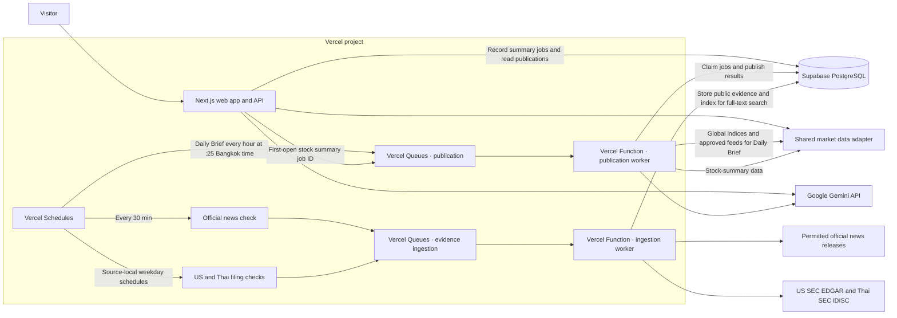

# Phase 1 architecture

Phase 1 covers shared Home content, Stock Detail, and grounded Q&A and comparison. Use the shared evidence and publication job contracts for these workflows. See the [Phase 1 requirements](functional-requirements.md) and [contracts and integration boundaries](../contracts-and-boundaries.md).

## Deployment

Vercel Schedules dispatches recurring news, filing, and Daily Brief jobs. Separate Vercel Queues and Functions handle ingestion and publication in the same Vercel project, starting on Hobby. The web server records a stock-summary job on first open and queues its ID. Supabase PostgreSQL stores evidence, job claims, and completed publications. [Hosting decision](../adr/0006-vercel-hosting-and-scheduled-publication-trigger.md) · [Publication consistency](../adr/0004-shared-publication-consistency.md)

## Retrieval and generation

On 20 November 2026, the owner chose PostgreSQL full-text search for the prototype. The prototype searches eligible passages with Thai word segmentation and exercises the same scope filters and citation format. Its text search provides the baseline for the bilingual evaluation.

The owner's 20 November 2026 prototype choice was `gemini-3.5-flash-lite` on the Gemini API free tier through `@ai-sdk/google`. The prototype must block sensitive, confidential, or personal information before sending a request to unpaid Gemini. Verify quota for an hourly brief alongside guest chat. [FR-20](functional-requirements.md#fr-20-personal-context-isolation)

See the [financial evidence retrieval RFC](../rfcs/financial-evidence-retrieval.md) for scope filters, citation handling, and evaluation. See the [AI workflow orchestration RFC](../rfcs/ai-workflow-orchestration.md) for shared workflow design.
